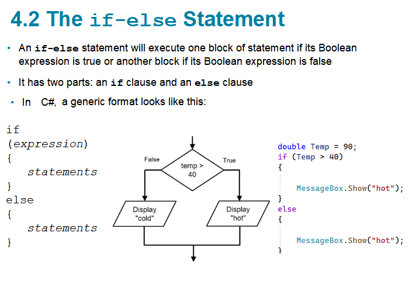
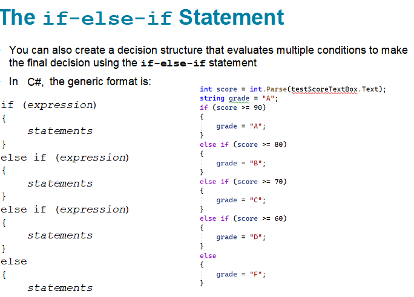
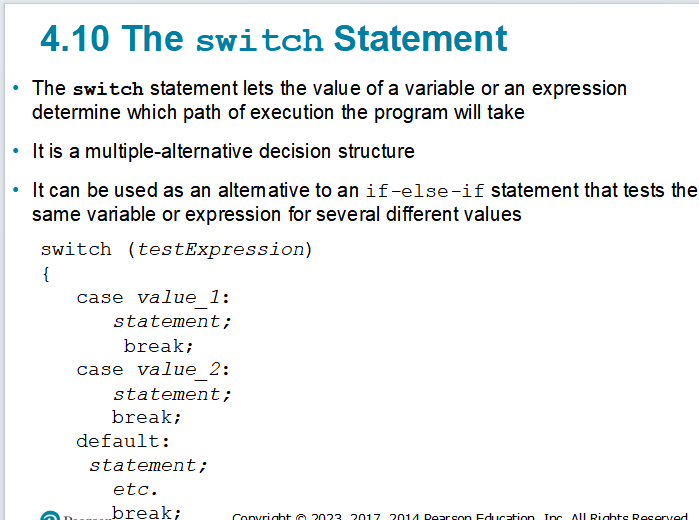
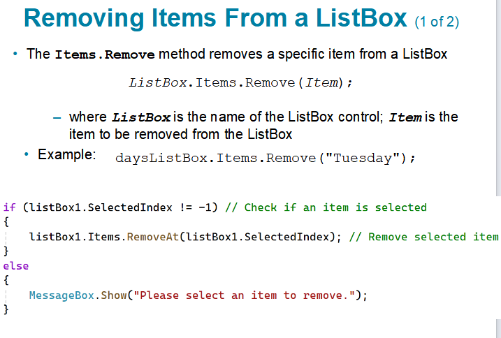

# Introduction to C# - Code Examples

## Topics

- The if-else Statement
- The if-else-if Statement
- The switch Statement
- Removing Items From a ListBox

## 1. The if-else Statement

An `if-else` statement executes one block of statements if its Boolean expression is `true`, or another block if the expression is `false`. It has two parts: an `if` clause and an `else` clause.

The following screenshot shows the if-else Statement example.



```csharp
double Temp = 90;
if (Temp > 40)
{
    MessageBox.Show("hot");
}
else
{
    MessageBox.Show("cold");
}
```

## 2. The if-else-if Statement

The `if-else-if` statement evaluates multiple conditions and makes the final decision. Conditions are checked from top to bottom; the first true one runs and the rest are skipped. The final `else` handles everything that did not match.

The following screenshot shows the if-else-if Statement example.



```csharp
int score = int.Parse(testScoreTextBox.Text);
string grade = "A";

if (score >= 90)
{
    grade = "A";
}
else if (score >= 80)
{
    grade = "B";
}
else if (score >= 70)
{
    grade = "C";
}
else if (score >= 60)
{
    grade = "D";
}
else
{
    grade = "F";
}
```

## 3. The switch Statement

The `switch` statement lets the value of a variable or expression determine which path the program takes. It is a multiple-alternative decision structure and can replace an `if-else-if` chain that tests the same variable against several values.

The following screenshot shows the switch Statement example.



```csharp
switch (testExpression)
{
    case value_1:
        statement;
        break;
    case value_2:
        statement;
        break;
    default:
        statement;
        break;
}
```

## 4. Removing Items From a ListBox

The `Items.Remove` method removes a specific item from a `ListBox`. To remove the selected item, check that `SelectedIndex` is not `-1`, then use `RemoveAt`.

The following screenshot shows the Removing Items From a ListBox example.



```csharp
daysListBox.Items.Remove("Tuesday");

if (listBox1.SelectedIndex != -1) // Check if an item is selected
{
    listBox1.Items.RemoveAt(listBox1.SelectedIndex); // Remove selected item
}
else
{
    MessageBox.Show("Please select an item to remove.");
}
```
