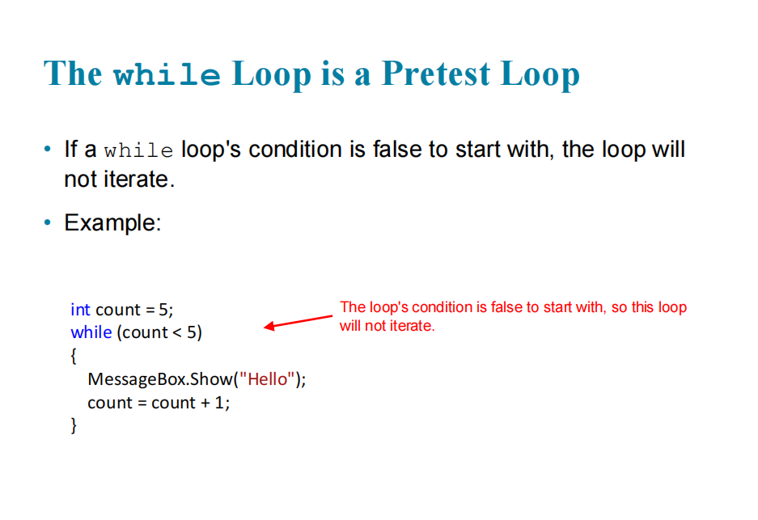
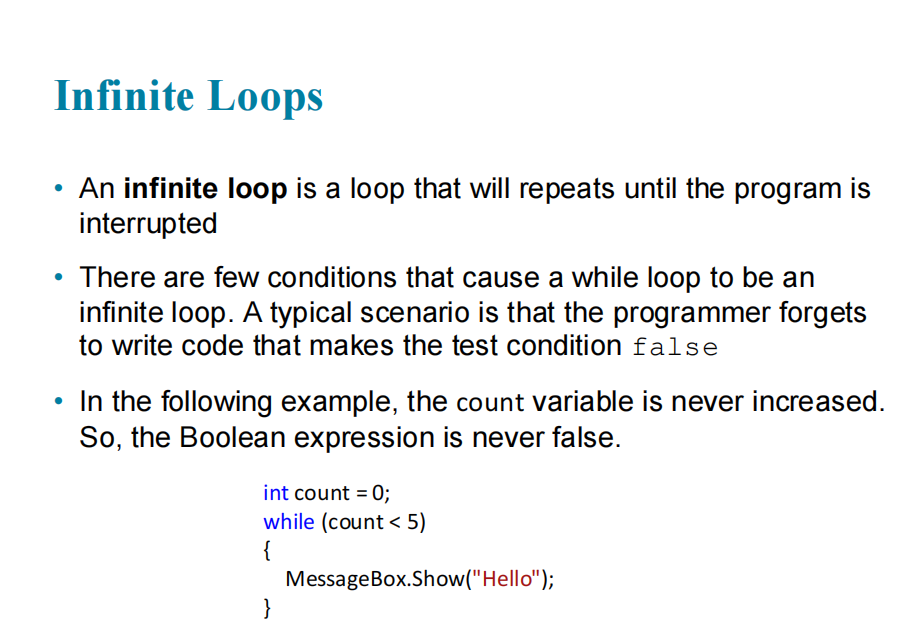
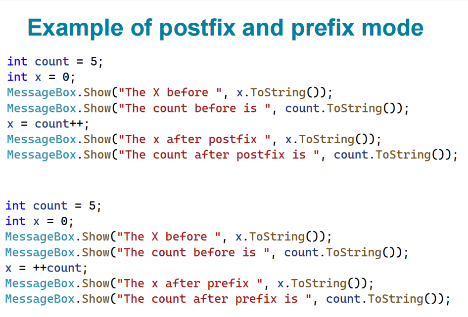
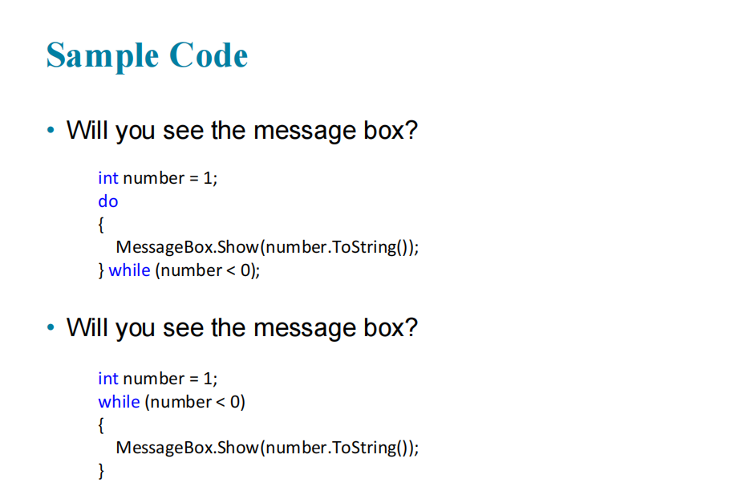

# Introduction to C# - Loops (Part 1)

## Topics

- The while Loop
- The ++ and -- Operators
- The for Loop
- The do-while Loop

## 1. The while Loop

A `while` loop repeats its body as long as a Boolean expression is `true`. It is a **pretest loop**: the condition is tested before each iteration, so it may never run.

```csharp
int count = 0;
while (count < 5)
{
    MessageBox.Show("Hello");
    count = count + 1;
}
```

The following screenshot shows a loop that does not iterate because its condition is false from the start.



An **infinite loop** never ends because the counter is never updated.



## 2. The ++ and -- Operators

`++` increments a variable by 1 and `--` decrements it by 1.

```csharp
count++;   // same as count += 1; or count = count + 1;
count--;   // same as count -= 1; or count = count - 1;
```

- **Postfix** (`count++`): use the old value, then change it.
- **Prefix** (`++count`): change the value first, then use it.



```csharp
int count = 5;
int x = count++;   // x = 5, count = 6
x = ++count;       // count = 7, x = 7
```

## 3. The for Loop

Used when a counter controls the loop. It has initialization, test, and update. It is also a pretest loop.

```csharp
for (int count = 0; count < 5; count++)
{
    MessageBox.Show("Hello");
}

// Count by 10, or backward
for (int count = 0; count <= 100; count += 10) { }
for (int count = 10; count >= 0; count--) { }
```

## 4. The do-while Loop

A **posttest loop**: the body runs once *before* the condition is tested, so it always iterates at least once.

```csharp
do
{
    statements
} while (BooleanExpression);
```



| Loop       | Condition tested | Minimum iterations |
|------------|------------------|--------------------|
| `while`    | Before the body  | 0                  |
| `for`      | Before the body  | 0                  |
| `do-while` | After the body   | 1                  |

## Practice Answers

- `number++` then `number--` from 5 shows **6**, then **5**.
- `while (count < 4)` starting at 0 iterates **4** times.
- `do-while` with `count < 0` iterates **1** time.
