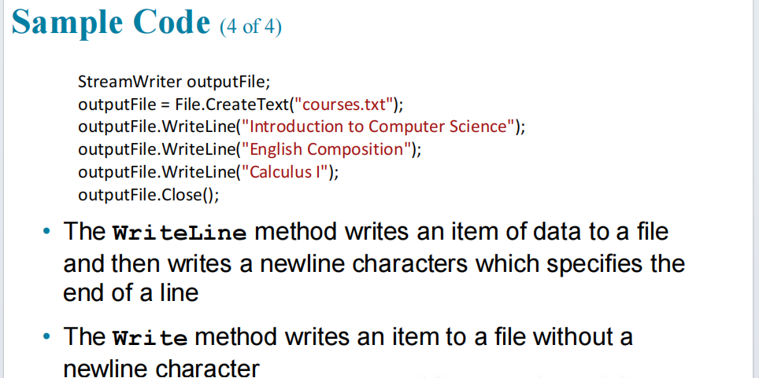

# C# File Input and Output (I/O) Operations

## Topics
1.Writing Data to a File
2.Reading Data from a File
3.Reading Line by Line with Error Handling
4.Using SaveFileDialog


## 1. Writing Data to a File

To write text data to a file, use the `StreamWriter` class along with `File.CreateText`.

```csharp
StreamWriter outputFile;
outputFile = File.CreateText("courses.txt");
outputFile.WriteLine("Introduction to Computer Science");
outputFile.WriteLine("English Composition");
outputFile.WriteLine("Calculus I");
outputFile.Close();
```



### Key Concepts:
* **`WriteLine`**: Writes an item of data to a file and automatically appends a newline character to specify the end of a line.
* **`Write`**: Writes an item of data to a file **without** adding a newline character.

---

## 2. Reading Data from a File

There are multiple ways to read content using `StreamReader` and the `File` class depending on the requirements:

```csharp
// Example 1: Read a single line
StreamReader read;
read = File.OpenText("lstcourse.doc");
string content;
content = read.ReadLine();
read.Close();

// Example 2: Read character by character
StreamReader read;
read = File.OpenText("lstcourse.doc");
char content;
content = (char)read.Read();
listBox1.Items.Add(content);
read.Close();

// Example 3: Read to the end of the file
StreamReader read;
read = File.OpenText("lstcourse.doc");
string content;
content = read.ReadToEnd();
listBox1.Items.Add(content);
read.Close();

// Example 4: Read all text directly using File.ReadAllText
string text;
text = File.ReadAllText("lstcourse.doc");
listBox1.Items.Add(text);
```


---

## 3. Reading Line by Line with Error Handling

When reading an entire file line-by-line, wrap the stream logic in a `try-catch` block to handle exceptions gracefully (e.g., file not found). Use `EndOfStream` in a `while` loop to iterate through every line.

```csharp
StreamReader reader;
try
{
    reader = File.OpenText("D:\\C#\\Last_Update_C#\\CA232\\EndBalanceCalc\\bin\\Debug\\listocurse1.doc");

    while (reader.EndOfStream == false)
    {
        string line;
        line = reader.ReadLine();
        listBox1.Items.Add(line);
    }

    reader.Close();
}
catch (Exception ex)
{
    MessageBox.Show(ex.Message);
}
```


---

## 4. Using SaveFileDialog

The `SaveFileDialog` control allows the user to specify the location and filename before creating/saving a file.

```csharp
StreamWriter write;

DialogResult result = saveFileDialog1.ShowDialog();

if (result == DialogResult.OK)
{
    // Create the file using the selected path
    write = File.CreateText(saveFileDialog1.FileName);
    write.WriteLine("Mohamed");
    write.Close();
}
else if (result == DialogResult.Cancel)
{
    MessageBox.Show("Wala Cancalay");
}
```

